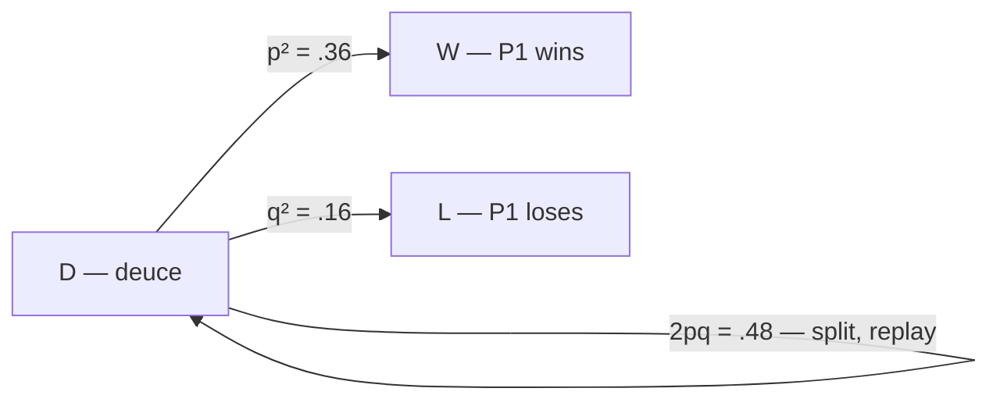

## Ace the data science interview, Chapter 5
### Redo exercises

| problem  | takeaway                                                  |
| -------- | --------------------------------------------------------- |
| 5.3      | hint: two step                                            |
| 5.8/5.16 | After two points, either game over or back to square one. |
| 5.9      | Bayes' Law                                                |
| 5.11     | Law of total probability                                  |
| 5.14     | Conditional space                                         |
| 5.17     | Be careful                                                |
| 5.18     | D.O.F.                                                    |
### Tricky exercises -- try before looking at hint
1. 5.10
> [! ]- hint
> find combinations of four endpoints.
2. 5.15
> [! ]- hint
> 1. The conditional space of `7 empty draws` is biased towards `not placed`. Namely, find $P(\text{placed}|\text{7 empty draws})$.
> 2. $EL=\text{8th draw has letter}, E7=\text{first seven draws empty}, L=\text{letter places}$. We are NOT asking for $P(EL|E7, L)$ coz $L$ is *not a known condition*. Instead, $$P(EL|E7)=P(EL, L|E7)=P(EL|L, E7)*P(L|E7).$$ First equal sign is obvious, second is definition of conditional prob.
3. 5.16 $\textemdash$ Markov chain solution
	1. states
		- $D$: deuce (tied)
		- $A$: player 1 has advantage (up by 1)
		- $B$: player 2 has advantage (down by 1)
		- $W$: player 1 wins the match (absorbing, $x_W=1$)
		- $L$: player 1 loses the match (absorbing, $x_L=0$)
	```mermaid
	flowchart LR
		B -->|q = .4| L["L — P1 loses"]
		B -->|p = .6| D["D — deuce"]
		D -->|q = .4| B["B — adv P2"]
		D -->|p = .6| A["A — adv P1"]
		A -->|q = .4| D
		A -->|p = .6| W["W — P1 wins"]
	```
	2. Let $x_D, x_A, x_B$ be the probability that player 1 eventually wins the match starting from each state. Conditioning on the next point: $$\begin{align*} x_A &= p \cdot 1 + q \cdot x_D \qquad \text{(win point → match won; lose it → deuce)} \\ x_B &= p \cdot x_D + q \cdot 0 \qquad \text{(win point → deuce; lose it → match lost)} \\ x_D &= p \cdot x_A + q \cdot x_B \qquad \text{(win point → } A\text{; lose it → } B\text{)} \end{align*}$$Then solve for $x_D$.
	3. Alternative: a two-step chain. Group the points into pairs. From deuce, one pair (block) has four equally-structured outcomes — row = winner of the 1st point, column = winner of the 2nd: $$
\begin{array}{c|cc}
 & \text{P1 wins 2nd} & \text{P2 wins 2nd} \\ \hline
\text{P1 wins 1st} & p^2 & pq \\
\text{P2 wins 1st} & pq & q^2
\end{array}$$ From the graph below, we have $x_D = 2pq*x_D + p^2*1$. 

